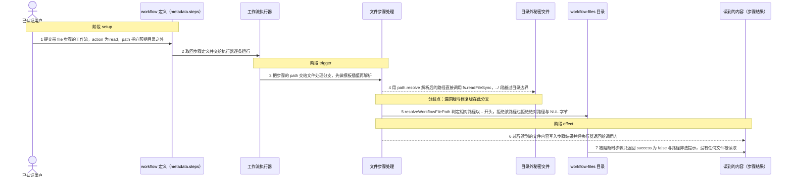
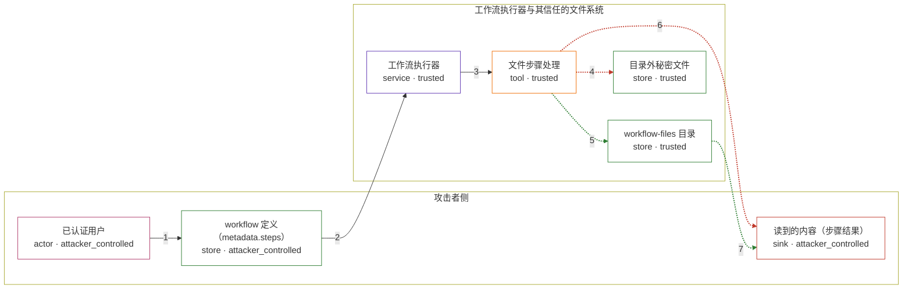

# ai-agent-automation / CVE-2026-54520

状态：草稿，未完成环境和复现。这个目录由模板生成，不构成漏洞确认。

图解的唯一来源是 `diagram.toml`：编辑后运行 `python3 -m runner diagram ai-agent-automation/CVE-2026-54520` 重新生成下方的图解区块。图解必须覆盖漏洞涉及的每个主体，并标出漏洞版/修复版的分歧步骤。

<!-- diagram:begin (generated from diagram.toml by `python3 -m runner diagram`; edit diagram.toml, not this block) -->
## 漏洞图解 — ai-agent-automation 工作流文件步骤路径穿越

工作流执行器 backend/src/agents/executor.js 的 file 分支把 step.path 先做模板插值再交给 path.resolve(process.cwd(), path)，既不做规范化约束也不做前缀包含性检查，因此 workflow-files 目录之外的相对路径与绝对路径都能通过。已认证用户提交 action 为 read 的 file 步骤，路径里的 ../ 段把读取目标指到预期目录之外，后端进程可读的秘密文件内容随步骤结果返回给调用方；修复版由 resolveWorkflowFilePath 先拒绝绝对路径与 NUL 字节、再以 workflow-files 为基目录用 path.relative 判定逃逸，同一输入被阻断且不产生文件系统效果。

### 涉及主体

| 主体 | 类型 | 信任级别 | 在漏洞里的作用 | 来源 |
| --- | --- | --- | --- | --- |
| 已认证用户 (`authenticated_user`) | `actor` | `attacker_controlled` | 凭有效 JWT 提交 workflow 定义，把 type 为 file、action 为 read、path 含 ../ 段的步骤写进自己的 workflow。 | — |
| workflow 定义（metadata.steps） (`workflow_definition`) | `store` | `attacker_controlled` | mongoose 的 Mixed 字段不做字段白名单，步骤里的 type/action/path 原样保存并交给执行器。 | fixtures/attack.json |
| 工作流执行器 (`step_runner`) | `service` | `trusted` | runner 循环取出步骤并调用 executeStep，file 分支对路径不做任何包含性校验，是缺失检查的位置。 | fixtures/attack.json |
| 文件步骤处理 (`file_tool`) | `tool` | `trusted` | 按 action 执行 read，对 step.path 先模板插值再 path.resolve(process.cwd(), path)，并把解析结果直接交给 fs 读取。 | — |
| workflow-files 目录 (`workflow_files_dir`) | `store` | `trusted` | 文件步骤本应只能在这个基目录内读写；路径解析以 process.cwd() 为基准，使 ../ 段得以离开该目录。 | — |
| 目录外秘密文件 (`secret_file`) | `store` | `trusted` | 位于预期目录之外、后端进程可读的文件，是越界读取的目标。 | — |
| 读到的内容（步骤结果） (`read_content`) | `sink` | `attacker_controlled` | 越界读取的内容随步骤的 output 字段返回给工作流调用方，攻击者由此拿到本不该读到的数据。 | — |

**信任边界**

- **攻击者侧** (`attacker_zone`)：成员 `authenticated_user`、`workflow_definition`、`read_content`。已认证用户完全控制自己 workflow 的步骤定义，也收到步骤结果，但读不到预期目录以外的文件。
- **工作流执行器与其信任的文件系统** (`workflow_runtime`)：成员 `step_runner`、`file_tool`、`workflow_files_dir`、`secret_file`。这道边界本来把文件步骤限制在 workflow-files 目录内，路径解析缺少包含性检查使它失效。

### 触发过程

### 主体与信任边界

箭头上的数字是上面的步骤编号；方框只标主体和信任级别，具体动作见「触发过程」。

**分歧点**：第 4 步（`vulnerable_only`）用 path.resolve 解析后的路径直接调用 fs.readFileSync，../ 段越过目录边界。
**分歧点**：第 5 步（`patched_only`）resolveWorkflowFilePath 判定相对路径以 .. 开头，拒绝该路径也拒绝绝对路径与 NUL 字节。
**分歧点**：第 6 步（`vulnerable_only`）越界读到的文件内容写入步骤结果并经执行器返回给调用方。
<!-- diagram:end -->

## 公告与机制

TODO：官方公告、漏洞根因、Agent 信任边界、受影响范围和修复来源。

## 前提

TODO：认证要求、用户交互、已有批准、工具权限、攻击者能控制的内容。

## 版本与启动

TODO：补全 metadata、Dockerfile/镜像 digest 和 Compose，再写出精确启动命令。

Compose 中 `vulnerable` 与 `patched` profiles 分开使用；未指定 profile 不启动服务。镜像变量未配置时 Compose 会明确报错。此模板不暴露宿主端口，也不挂载主机数据。

## 机制复现

TODO：实现 `reproduce.py`，固定输入并执行真实漏洞路径，注明运行位置、参数和超时。

完成实现后使用 `python3 -m runner reproduce ai-agent-automation/CVE-2026-54520 --build --rounds 3`。
两脚本统一接受 `--context <context.json> --output <目录>`，详细字段见仓库 `docs/environment-contract.md`。
PoC 输出 `facts.json` 和效果文件；验证器只读证据，输出含 `target_ready` 及对应效果断言的 `verdict.json`。
镜像必须包含 Python 3 和 `/lab/` 下的脚本、fixtures；`runtime.mode` 选择 `oneshot` 或有 healthcheck 的 `service`。

## 端到端复现

TODO：实现 `end_to_end.py`；若不需要模型，明确写出不适用原因。真实模型的结果与机制复现分开统计。

## 验证与修复对照

TODO：实现 `verify.py`。记录漏洞版无害效果、修复版阻断和正常任务成功的证据，不能把服务启动失败当成阻断。

## 清理

默认运行器按每个测试的唯一 Compose project 清理容器、网络和 volume。
`--keep-on-failure` 保留失败项目，项目标识和 Compose 配置在结果目录中；仅清理该项目，不能使用全局 prune。

## 失败诊断

TODO：为本漏洞写出预期效果缺失、修复版仍有越界效果、正常任务失败及前提不满足时的具体排查路径。
启动失败、健康检查失败和超时都不能当作修复阻断。报告中应能定位到阶段、预期、实际和受控证据。

## 构建与输入

TODO：填写两版源码 archive、完整 commit，记录 `build.inputs` 中每个下载的 SHA-256；依赖安装必须支持禁网构建。
固定攻击和正常输入放入 `fixtures/` 并登记到 `fixtures/manifest.toml`。固定 seed、环境变量，说明无害效果与真实影响的关系。

## 隔离例外

默认无例外。确需例外时同时填写 `runtime.exceptions`、理由及最小范围，晋升由两位维护者审阅。

## 来源与许可

TODO：列出引用代码、fixtures 和镜像的来源及许可。
