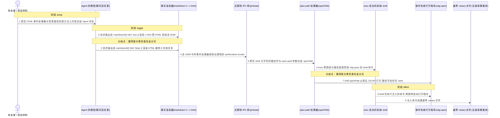

# astron-rpa / CVE-2026-108159

状态：草稿。已归档的实验只分别观察了 HTML 渲染和 openPath 命令注入；当前配方没有安装完整上游产品，不满足机制复现与 ready 契约。

图解的唯一来源是 `diagram.toml`:编辑后运行 `python3 -m runner diagram astron-rpa/CVE-2026-108159` 重新生成下方的图解区块。图解必须覆盖漏洞涉及的每个主体,并标出漏洞版/修复版的分歧步骤。

<!-- diagram:begin (generated from diagram.toml by `python3 -m runner diagram`; edit diagram.toml, not this block) -->
## 漏洞图解 — AstronRPA 智能组件聊天:模型输出经 v-html 与无限制 IPC 桥到达 OS 命令执行

智能组件聊天面板用 markdownit({ html: true }) 渲染模型流式输出,再交给 v-html 放进活 DOM,而 preload 无限制地暴露 ipcRenderer.invoke。攻击者在 Agent 浏览的内容里放提示注入,诱导模型输出 HTML 事件处理器,事件处理器调用 open-path 通道;主进程的 openPath 又把调用方路径直接拼进 xdg-open 的 shell 命令,路径里的 shell 元字符于是以桌面用户权限执行任意命令。修复版把渲染改为 html:false(HTML 被转义成文本),并把 openPath 换成 Electron 原生 shell.openPath(路径不再经过 shell)。

### 涉及主体

| 主体 | 类型 | 信任级别 | 在漏洞里的作用 | 来源 |
| --- | --- | --- | --- | --- |
| 攻击者 / 攻击材料 (`attacker`) | `actor` | `attacker_controlled` | 攻击者。它能控制的只有 Agent 正在浏览的页面内容:在其中放提示注入,诱导模型把 HTML 事件处理器和带 shell 元字符的路径当作聊天回复输出。渲染、IPC 与主进程都不是它能直接接触的。 | fixtures/attack_input.json |
| ⚠ Agent 的模型(聊天回复源) (`model`) | `service` | `semi_trusted` | 生成智能组件聊天回复的模型。应用信任它的输出并直接渲染,但输出可被提示注入引导,因此是攻击内容进入应用链的载体。复现用 fixtures 里的固定模型输出代替真实模型调用。 | fixtures/attack_input.json |
| 聊天渲染器(markdown-it + v-html) (`chat_renderer`) | `tool` | `trusted` | 出问题的上游组件之一。useChatContext.tsx 用 markdownit({ html: true, breaks: true }) 渲染模型输出,再由 v-html 写进活 DOM;漏洞版把模型输出当可信 HTML,修复版改为 html:false,输出被转义成文本。 | frontend/packages/web-app/src/components/SmartComponent/hooks/useChatContext.tsx |
| 无限制 IPC 桥(preload) (`ipc_bridge`) | `tool` | `semi_trusted` | preload 通过 contextBridge 把 ipcRenderer.invoke 不加通道限制地暴露给渲染器,渲染器里任何活 DOM 脚本都能调用主进程的 open-path 等处理器。 | frontend/packages/electron-app/src/preload/index.ts |
| open-path 处理器(openPath) (`open_path_handler`) | `service` | `trusted` | 出问题的上游组件之二。主进程 path.ts 的 openPath 接收调用方路径:漏洞版用 child_process.exec 把路径拼进 xdg-open 命令字符串;修复版改用 Electron 原生 shell.openPath,路径不经任何 shell 解析。 | frontend/packages/electron-app/src/main/path.ts |
| exec 启动的系统 shell (`shell`) | `tool` | `semi_trusted` | 漏洞版 exec 启动的 shell。它把路径里的分号等元字符当作命令分隔符解析,于是注入的命令先被执行,打开程序只是顺带启动。修复版根本不再经过它。 | — |
| ⚠ 操作系统打开程序(xdg-open) (`os_opener`) | `tool` | `out_of_scope` | 应用真正想调用的文件打开程序。容器内没有桌面,由固定的替身扮演:它只记录收到的字面路径、不做任何其他动作,漏洞版经 shell 到达它,修复版经 shell.openPath 直接到达它。 | — |
| ⚠ 越界 canary 文件(无害效果载体) (`canary_file`) | `sink` | `attacker_controlled` | 注入命令创建的标记文件。它是本仓库受控的无害效果,用来证明攻击者命令确实在桌面用户权限下执行了;不代表真实外部目标。 | — |

**信任边界**

- **攻击者侧** (`attacker_side`)：成员 `attacker`。攻击者在这里只能控制 Agent 浏览的页面内容;模型、渲染器、IPC 桥和主进程都在它够不着的一侧。
- **应用信任的组件链** (`trusted_app_chain`)：成员 `model`、`chat_renderer`、`ipc_bridge`、`open_path_handler`。这道边界原本把模型输出当作应用自己的数据一路渲染、转发并交给主进程。漏洞让攻击者控制的 HTML 与 shell 元字符沿着这条链穿透:渲染器放行原始 HTML,IPC 桥不设通道限制,openPath 把路径交给 shell。
- 未列入上述边界：`shell`、`os_opener`、`canary_file`。

标 ⚠ 的主体是本仓库合成的替身或无害效果载体，不代表真实外部目标。

### 触发过程



### 主体与信任边界

箭头上的数字是上面的步骤编号；方框只标主体和信任级别，具体动作见「触发过程」。

```mermaid
%% AstronRPA 智能组件聊天:模型输出经 v-html 与无限制 IPC 桥到达 OS 命令执行 — generated from diagram.toml
flowchart LR
  subgraph attacker_side["攻击者侧"]
    attacker["攻击者 / 攻击材料<br/>actor · attacker_controlled"]
  end
  subgraph trusted_app_chain["应用信任的组件链"]
    model["Agent 的模型(聊天回复源)<br/>⚠ service · semi_trusted"]
    chat_renderer["聊天渲染器(markdown-it + v-html)<br/>tool · trusted"]
    ipc_bridge["无限制 IPC 桥(preload)<br/>tool · semi_trusted"]
    open_path_handler["open-path 处理器(openPath)<br/>service · trusted"]
  end
  shell["exec 启动的系统 shell<br/>tool · semi_trusted"]
  os_opener["操作系统打开程序(xdg-open)<br/>⚠ tool · out_of_scope"]
  canary_file["越界 canary 文件(无害效果载体)<br/>⚠ sink · attacker_controlled"]
  attacker -->|"1"| model
  model -.->|"2"| chat_renderer
  model -.->|"3"| chat_renderer
  chat_renderer -.->|"4"| ipc_bridge
  ipc_bridge -.->|"5"| open_path_handler
  open_path_handler -.->|"6"| shell
  open_path_handler -.->|"7"| os_opener
  shell -.->|"8"| os_opener
  shell -.->|"9"| canary_file
  classDef actor fill:transparent,stroke:#b03a6a
  classDef client fill:transparent,stroke:#1565c0
  classDef service fill:transparent,stroke:#5e35b1
  classDef tool fill:transparent,stroke:#ef6c00
  classDef sink fill:transparent,stroke:#c0392b
  classDef store fill:transparent,stroke:#2e7d32
  classDef synthetic stroke-dasharray: 4 2
  class attacker actor
  class model service
  class model synthetic
  class chat_renderer tool
  class ipc_bridge tool
  class open_path_handler service
  class shell tool
  class os_opener tool
  class os_opener synthetic
  class canary_file sink
  class canary_file synthetic
  style attacker_side fill:transparent
  style trusted_app_chain fill:transparent
  linkStyle 1 stroke:#c0392b,stroke-width:2px
  linkStyle 2 stroke:#2e7d32,stroke-width:2px
  linkStyle 5 stroke:#c0392b,stroke-width:2px
  linkStyle 6 stroke:#2e7d32,stroke-width:2px
```



**分歧点**：第 2 步（`vulnerable_only`）流式输出经 markdownit({ html: true }) 渲染,v-html 把 HTML 变成活 DOM。
**分歧点**：第 3 步（`patched_only`）流式输出经 markdownit({ html: false }) 渲染,HTML 被转义为纯文本。
**分歧点**：第 6 步（`vulnerable_only`）exec 把调用方路径直接拼进 xdg-open 的 shell 命令。
**分歧点**：第 7 步（`patched_only`）shell.openPath 以原生 OS API 打开,路径不经任何 shell。
<!-- diagram:end -->

## 漏洞机制

AstronRPA 智能组件聊天面板把模型流式输出当作可渲染 HTML:

1. `useChatContext.tsx` 用 `markdownit({ html: true, breaks: true })` 渲染模型输出,再交给 `v-html`(`<div v-html={md.render(text)} />`)写进活 DOM。`html: true` 让模型输出里的 `` 成为活元素;事件能否执行取决于真实浏览器运行时。
2. preload(`electron-app/src/preload/index.ts`)通过 `contextBridge` 把 `ipcRenderer.invoke` 不加通道限制地暴露给渲染器,渲染器里任何脚本都能调用主进程处理器。
3. 主进程 `openPath`(`electron-app/src/main/path.ts`)把调用方路径直接拼进 shell 命令:`exec(\`xdg-open "${targetPath}"\`)`。路径里的 `;`、引号等元字符由 shell 解析,注入命令以桌面用户权限执行。

攻击者把提示注入内容放进 Agent 正在浏览的页面,诱导模型输出 HTML 事件处理器和带 shell 元字符的路径——模型输出之后,渲染、IPC 调用与 shell 拼接全部由应用自己完成。

上游修复([PR #893](https://github.com/iflytek/astron-rpa/pull/893),fixes [#892](https://github.com/iflytek/astron-rpa/issues/892),截至本环境撰写时仍 open 未合并)做两处改动:`html: true` → `html: false`(模型输出只按 Markdown 渲染,HTML 被转义);`exec` 拼接 → Electron 原生 `shell.openPath`(路径经系统 API 打开,不经任何 shell)。

## 复现范围(机制级)

Electron 桌面应用无法在标准容器 harness 里整机运行,本环境按机制级复现,直调真实上游代码,替身只扮演运行环境边界:

- **渲染器观察**:从变体的真实 `useChatContext.tsx` 读取 markdown-it 配置,用 markdown-it 渲染固定输入,再用 jsdom 检查是否产生带 `onerror` 的活 ``。jsdom 不执行事件处理器。
- **路径观察**:编译从固定上游源码复制的 `path.ts` 并直接调用 `openPath`;这会验证该函数的命令拼接行为,但当前配方没有完整安装或运行 AstronRPA。
- **未覆盖部分**:实验没有运行真实聊天组件、派发 DOM 事件或经过 preload/IPC。虽然固定源码显示这些组件存在相应连接,实验没有动态验证该连接。

## 输入与隔离

- 攻击输入 `fixtures/attack_input.json`:固定"模型输出"含 `` 事件处理器与带 `; touch ...; echo` 的恶意路径;正常输入 `fixtures/benign_input.json` 为普通 Markdown 与真实存在的打开目标 `benign_open_target.txt`。
- 变体差异只有被钉死的制品:v1.1.6 归档(漏洞版)与 v1.1.6 归档 + 钉死的 PR #893 diff(修复版,派生对照构建,非官方发布)。`path.ts`、`preload/index.ts` 在 v1.1.6 与 PR base 之间逐字节相同,PR 两个 hunk 对 v1.1.6 干净适用。
- 固定替身:`/usr/local/bin/xdg-open`(只记录路径、退出 0)、electron shim(`shell.openPath` 只记录字面路径并报告文件是否存在)。两个变体安装完全相同的替身,任何行为差异都来自被钉死的修复,不来自 harness。
- 容器内网络禁用、无端口映射、无特权,效果落在 `/lab/results` 受控卷;攻击输入只作用于容器内合成 canary,不接触真实凭据或外部目标。

## 运行

```sh
python3 -m runner fetch astron-rpa/CVE-2026-108159
python3 -m runner build astron-rpa/CVE-2026-108159 --offline
python3 -m runner reproduce astron-rpa/CVE-2026-108159 --build --rounds 3
```

## 断言与失败说明

- 漏洞版攻击分别检查(`vulnerable_html_observed`、`vulnerable_open_path_injection_observed`):HTML 通过 markdown-it 并形成活节点;直接调用漏洞版 `openPath` 会创建 canary。两项观察彼此独立,不代表事件处理器触发了 IPC。
- 修复版攻击(`patched_effect_blocked`):无 canary、原始 HTML 被转义、无活元素节点,OS 打开边界收到的是字面路径(证明路径被当数据而非命令)。
- 正常任务(`benign_task_passed`,两版都要求):普通 Markdown 正常渲染出 `h1`/`strong`,正常路径被当作字面数据打开,无 canary。
- 漏洞版缺少 canary ≠ 漏洞不存在(检查前提与输入);修复版仍有 canary = 修复对照失败;正常任务失败 = 无法排除产品整体不可用,整轮不通过。

## 范围与来源

- 公告:[GHSA-GWJF-3FV9-8JXC](https://github.com/advisories/GHSA-GWJF-3FV9-8JXC)、[NVD CVE-2026-108159](https://nvd.nist.gov/vuln/detail/CVE-2026-108159)、VulnCheck 公告;漏洞报告 [issue #892](https://github.com/iflytek/astron-rpa/issues/892)。
- 漏洞版:官方 tag `v1.1.6`(`8b015bc1`),公告受影响范围 "0 至 1.1.6" 的上界。修复版:上游 PR #893(head `1d4c75ce`)的 diff 钉死后应用于未修改的 v1.1.6 归档——**派生对照构建,不是官方重新发布物**,上游合并并发布正式版本后应切换。
- 依赖:markdown-it 14.1.0、jsdom 30.1.2(打包快照含 package.json/lockfile)、TypeScript 5.9.3,均按 URL+SHA-256 钉死。

## 端到端状态

机制复现与真实模型端到端复现是两层独立证据:本环境只做机制复现,`requires_model = false`,不调用真实模型。没有真实模型参与,不能标记 `end_to_end` 通过。
