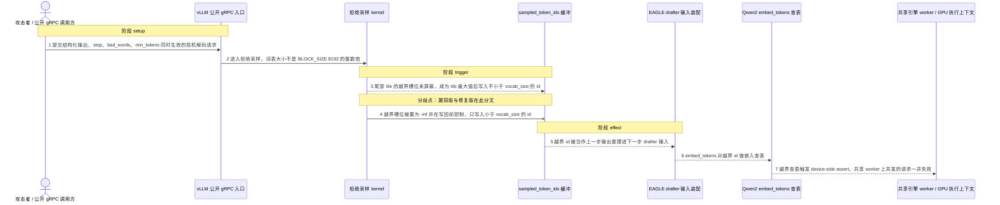

# vllm / CVE-2026-54234

状态：草稿，机制在当前平台上无法复现（见「失败诊断」）。图解的根因、修复位置和两端源码都已逐行核对，但漏洞效果依赖 GPU 上的 Triton 归约语义，本仓库的容器模型不允许把 GPU 设备传进容器，因此 `generate` 阶段以 `error` 结束，环境保持 `draft`。

图解的唯一来源是 `diagram.toml`：编辑后运行 `python3 -m runner diagram vllm/CVE-2026-54234` 重新生成下方的图解区块。图解必须覆盖漏洞涉及的每个主体，并标出漏洞版/修复版的分歧步骤。

<!-- diagram:begin (generated from diagram.toml by `python3 -m runner diagram`; edit diagram.toml, not this block) -->
## 漏洞图解 — vLLM 投机解码 recovered token 越界重注入

投机解码的拒绝采样按 BLOCK_SIZE=8192 分块归约 target_probs 与 1/q，最后一个 tile 越过词表边界，越界槽位以 0 分参与归约。当该 tile 的合法位置没有有限得分（例如请求的采样约束掩码掉整个词表、逐行 softmax 得到整行 NaN 的调整目标分布）时，0 分的越界槽位成为 tile 最大值，kernel 于是把 id >= vocab_size 的 recovered token 写回采样缓冲。该 id 随后被当作下一步的 drafter 输入重新嵌入，越界查表在共享 worker 上触发 device-side assert，并发请求连同 worker 一起失败。修复版把越界槽位置为 -inf 并在写回前钳制，越界 id 不再产生。

### 涉及主体

| 主体 | 类型 | 信任级别 | 在漏洞里的作用 | 来源 |
| --- | --- | --- | --- | --- |
| 攻击者 / 公开 gRPC 调用方 (`attacker`) | `actor` | `attacker_controlled` | 提交采样约束合法、但会让目标分布退化的投机解码请求，并用并发请求与取消制造流式 overlap；它拿不到模型权重、词表大小或 kernel 实现。 | — |
| vLLM 公开 gRPC 入口 (`gateway`) | `service` | `semi_trusted` | 把请求的采样参数、取消信号与并发调度翻译成引擎内部工作项，是攻击者唯一能触及的接口面。 | — |
| 拒绝采样 kernel (`sampler`) | `service` | `trusted` | sample_recovered_tokens_kernel 分块归约 target_probs 与 1/q，为每个未接受槽位选出 recovered token id。 | vllm/v1/sample/rejection_sampler.py |
| sampled_token_ids 缓冲 (`token_buffer`) | `store` | `trusted` | 保存本步输出 token id 的缓冲；未接受槽位保持占位值 -1，越界 id 也写在这里。 | — |
| EAGLE drafter 输入装配 (`drafter`) | `service` | `trusted` | 把上一步的采样输出整理成下一步 drafter 输入，上一轮的越界 id 在这里被重新注入。 | — |
| Qwen2 embed_tokens 查表 (`embedding`) | `service` | `trusted` | 对输入 id 做嵌入查表；id 越出词表范围时该次查表在 GPU 上触发断言。 | — |
| 共享引擎 worker / GPU 执行上下文 (`worker`) | `sink` | `trusted` | 承载同一 worker 上所有并发请求的执行上下文，一次 device-side assert 会让整个 worker 崩溃。 | — |

**信任边界**

- **公开推理接口** (`request_surface`)：成员 `attacker`、`gateway`。边界内是未经认证的请求参数与调度时序。攻击者能控制请求内容与并发，不能控制模型权重、词表大小或 kernel 实现。
- **投机解码引擎与 GPU 执行上下文** (`engine`)：成员 `sampler`、`token_buffer`、`drafter`、`embedding`、`worker`。这道边界把不受信的请求参数与受信的采样、装配、嵌入代码隔开；漏洞让一个越界 id 穿过采样结果，进入后续 drafter 与嵌入查表。

### 触发过程

### 主体与信任边界

箭头上的数字是上面的步骤编号；方框只标主体和信任级别，具体动作见「触发过程」。

```mermaid
%% vLLM 投机解码 recovered token 越界重注入 — generated from diagram.toml
flowchart LR
  subgraph request_surface["公开推理接口"]
    attacker["攻击者 / 公开 gRPC 调用方<br/>actor · attacker_controlled"]
    gateway["vLLM 公开 gRPC 入口<br/>service · semi_trusted"]
  end
  subgraph engine["投机解码引擎与 GPU 执行上下文"]
    sampler["拒绝采样 kernel<br/>service · trusted"]
    token_buffer["sampled_token_ids 缓冲<br/>store · trusted"]
    drafter["EAGLE drafter 输入装配<br/>service · trusted"]
    embedding["Qwen2 embed_tokens 查表<br/>service · trusted"]
    worker["共享引擎 worker / GPU 执行上下文<br/>sink · trusted"]
  end
  attacker -->|"1"| gateway
  gateway -->|"2"| sampler
  sampler -.->|"3"| token_buffer
  sampler -.->|"4"| token_buffer
  token_buffer -.->|"5"| drafter
  drafter -.->|"6"| embedding
  embedding -.->|"7"| worker
  classDef actor fill:transparent,stroke:#b03a6a
  classDef client fill:transparent,stroke:#1565c0
  classDef service fill:transparent,stroke:#5e35b1
  classDef tool fill:transparent,stroke:#ef6c00
  classDef sink fill:transparent,stroke:#c0392b
  classDef store fill:transparent,stroke:#2e7d32
  classDef synthetic stroke-dasharray: 4 2
  class attacker actor
  class gateway service
  class sampler service
  class token_buffer store
  class drafter service
  class embedding service
  class worker sink
  style request_surface fill:transparent
  style engine fill:transparent
  linkStyle 2 stroke:#c0392b,stroke-width:2px
  linkStyle 3 stroke:#2e7d32,stroke-width:2px
```

**分歧点**：第 3 步（`vulnerable_only`）尾部 tile 的越界槽位未屏蔽，成为 tile 最大值后写入不小于 vocab_size 的 id。
**分歧点**：第 4 步（`patched_only`）越界槽位被置为 -inf 并在写回前钳制，只写入小于 vocab_size 的 id。
<!-- diagram:end -->

## 公告与机制

- 公告：<https://github.com/advisories/GHSA-8wr5-jm2h-8r4f>（`CVE-2026-54234`，HIGH，`CWE-1284`/`CWE-20`）。
- 受影响范围（GHSA ECOSYSTEM range）：`introduced 0.17.1` → `fixed 0.24.0`；报告确认可复现 `v0.17.1`（`95c0f928cdeeaa21c4906e73cee6a156e1b3b995`）。
- 漏洞文件：`vllm/v1/sample/rejection_sampler.py`，Triton kernel `sample_recovered_tokens_kernel`。
- 修复提交：`8a5cf1ccd65e8ac7635c402c1ec0b08988bc26ca`（PR #44744），其父提交为 `fe1d923afccb2eba49e7525389ddf1e81ef6b7dd`。
- 修复内容（7 行改动）：1) `score = tl.where(vocab_mask, score, float("-inf"))`，把越界槽位屏蔽出 `tl.max` 的取值裁决；2) `recovered_id = tl.minimum(recovered_id, vocab_size - 1)`，写回前钳制。

根因：kernel 用 `BLOCK_SIZE = 8192` 分块遍历词表，最后一个 tile 会越过 `vocab_size`。越界槽位的 `prob` 与 `inv_q` 都是以 `mask=vocab_mask, other=0.0` 载入的，得分恒为 0；当该 tile 内合法位置的得分也全为 0 时，越界槽位可能赢得 `tl.max(..., return_indices=True)` 的裁决，于是 `recovered_id = v + local_id >= vocab_size`。同链条下游还有 `vllm/v1/spec_decode/utils.py::eagle_prepare_next_token_padded_kernel`（拒绝该 id）、`vllm/model_executor/models/qwen2.py::embed_tokens`（越界查表触发 device-side assert）。

Agent 信任边界：攻击者只是公开推理接口的调用方，能控制采样参数、取消信号与并发时序，不能控制模型权重、词表大小或 kernel 实现。因此边界两侧是「不受信的请求参数」与「受信的采样/装配/模型代码」。

## 前提

- 推理服务开启投机解码，且被投机的模型词表大小不是 8192 的整数倍（报告使用 `Qwen/Qwen3-0.6B-GPTQ-Int8`，`vocab_size = 151936`）。
- 一个 `vllm.v1.sample.rejection_sampler` 会被执行到的请求：采样约束（结构化输出、`stop`、`bad_words`、`min_tokens`）与流式 overlap、请求取消同时活跃，使目标分布在词表尾部退化为零概率。
- **平台前提：可执行 Triton kernel 的 NVIDIA GPU。** 这是本环境当前缺失的一项，细则见「失败诊断」。

## 版本与启动

`generate` 阶段不写 `metadata.toml`/`Dockerfile`（由 `build` 阶段负责），当前两版 archive 尚未固定、配方仍是模板，因此本环境无法启动。要恢复本环境，需要先固定两版源码归档 `https://github.com/vllm-project/vllm/archive/<sha>.tar.gz`（`fe1d923a…` 与 `8a5cf1cc…`）以及包含 `torch`、`triton` 的离线基础镜像 digest。

Compose 中 `vulnerable` 与 `patched` profiles 分开使用；未指定 profile 不启动服务。镜像变量未配置时 Compose 会明确报错。此模板不暴露宿主端口，也不挂载主机数据。

## 机制复现

`reproduce.py` 已实现：它从镜像里固定的 `vllm/v1/sample/rejection_sampler.py` 加载上游模块本体（只对与本 kernel 无关的 `vllm.*` 导入做桩），按 `fixtures/attack.json` 或 `fixtures/benign.json` 构造张量，然后调用上游自己的 `sample_recovered_tokens()`，把 kernel 真正写出的 recovered token id 记为效果。无 CUDA 设备时以 `TRITON_INTERPRET=1` 在 CPU 上解释执行同一份 Triton 源码。

实测（本机，`torch 2.14.0+cpu`、`triton 3.8.0`、无 GPU）：

| 变体 | attack 输出 | benign 输出 |
| --- | --- | --- |
| vulnerable | `[0, 0, 0, 0, 0, 0]` | `[42, 42, 42, 42, 42, 42]` |
| patched | `[0, 0, 0, 0, 0, 0]` | `[42, 42, 42, 42, 42, 42]` |

即两版在 CPU 解释器下逐字节相同，漏洞效果没有出现。`--context`/`--output` 契约见 `docs/environment-contract.md`。
PoC 输出 `facts.json` 和效果文件；验证器只读证据，输出含 `target_ready` 及对应效果断言的 `verdict.json`。
镜像必须包含 Python 3 和 `/lab/` 下的脚本、fixtures；`runtime.mode` 选择 `oneshot` 或有 healthcheck 的 `service`。

## 端到端复现

不适用（`metadata.toml` 的 `verification.end_to_end.status = "not_applicable"`）：报告的实际影响是 GPU 上的 device-side assert 与引擎 worker 崩溃，需要在开启投机解码的 vLLM 服务上跑真实模型（报告使用 `Qwen/Qwen3-0.6B-GPTQ-Int8`）。这需要 GPU 与模型权重，超出机制复现的范围；真实模型结果应与机制结果分开统计。

## 验证与修复对照

`verify.py` 仍由 `validate` 阶段实现。在当前平台上，漏洞版效果（存在 `recovered_id >= vocab_size`）无法出现，因此四场景验收不可能通过；把 CPU 解释器的结果当作漏洞证据是不允许的。恢复验收需要先在带 NVIDIA GPU 的隔离环境里让漏洞版攻击稳定产生越界 id。

## 清理

默认运行器按每个测试的唯一 Compose project 清理容器、网络和 volume。
`--keep-on-failure` 保留失败项目，项目标识和 Compose 配置在结果目录中；仅清理该项目，不能使用全局 prune。

## 失败诊断

**本环境被平台阻塞，`generate` 阶段状态为 `error`。** 缺的是可执行该 Triton kernel 的 NVIDIA GPU（以及把该设备传进容器的能力）。

- `runner/compose.py` 明确拒绝 `devices` 字段，`runner/` 中没有任何 GPU/设备透传支持，本机也没有 `nvidia-smi` 与 `/dev/nvidia*`。
- 无 GPU 时唯一能跑「真实 kernel 源码」的路径是 `TRITON_INTERPRET=1`。实测（triton 3.8.0）解释器的归约用 `np.nanargmax`，对并列值取**最左**下标；而越界槽位只存在于每个 tile 的最右端，因此越界槽位永远赢不了裁决。对有限、非负的 `prob`（softmax/`tl.maximum` 的产物）可以证明漏洞版输出必然落在 `[0, vocab_size)` 内：`recovered_id` 只可能是某个合法下标的 tile 内 argmax，或是 `v` 本身，而两者都小于 `vocab_size`。
- 覆盖 `vocab_size ∈ {1,2,10,100,1000,8191,8192,8193,10000}` × 5 种概率形态 × draft/no-draft × 3 个 seed 的 540 次解释器试验中，漏洞版越界命中为 0。
- 上游回归测试 `test_sample_recovered_tokens_vocab_boundary` 的两条参数化输入在解释器下对两版给出完全相同的输出（见「机制复现」表）。

预期效果缺失时（无 GPU 主机）：`reproduce.py` 会以 `execution_status = "completed"`、`out_of_vocabulary_ids = []` 记录这次真实执行，`verify.py` 应据实判 `vulnerable_effect_observed = false`，**不得**用人工构造的 `inv_q`、NaN 概率或负概率去制造越界 id。修复版仍有越界效果、正常任务失败或前提不满足时，同样如实记录阶段、预期、实际与受控证据。

## 构建与输入

待 `build` 阶段填写：两版源码 archive（`fe1d923afccb2eba49e7525389ddf1e81ef6b7dd`、`8a5cf1ccd65e8ac7635c402c1ec0b08988bc26ca`）、完整 commit、`build.inputs` 中每个下载的 URL 与 SHA-256，以及能离线提供 `torch`/`triton` 的基础镜像 digest。

固定攻击与正常输入已在 `fixtures/attack.json` 与 `fixtures/benign.json`，并登记到 `fixtures/manifest.toml`；两文件都固定了 `q_seed`、`draft_token_ids`、`batch_size`、`max_spec_len`。`attack.json` 的效果是 kernel 真实写回的越界 token id（受控效果），真实影响（worker 崩溃）由该越界 id 的重注入产生，两者分开记录。

## 隔离例外

默认无例外。本环境需要的 GPU 设备透传在 `runner/compose.py` 中不被允许；若要恢复本环境，必须先扩展共享工具链并走审阅，**不能**在环境内私开例外。

## 来源与许可

- 上游源码：`vllm-project/vllm`（Apache-2.0），`vllm/v1/sample/rejection_sampler.py`、`vllm/v1/spec_decode/utils.py`、`vllm/model_executor/models/qwen2.py`、`vllm/entrypoints/grpc_server.py`，以及回归测试 `tests/v1/sample/test_rejection_sampler.py`。
- 公告/修复来源：<https://github.com/advisories/GHSA-8wr5-jm2h-8r4f>、<https://github.com/vllm-project/vllm/commit/8a5cf1ccd65e8ac7635c402c1ec0b08988bc26ca>、<https://github.com/vllm-project/vllm/pull/44744>。
- 本目录的 fixtures 与脚本为本仓库合成的固定输入与驱动代码，不含真实凭据、真实用户数据或宿主路径。
