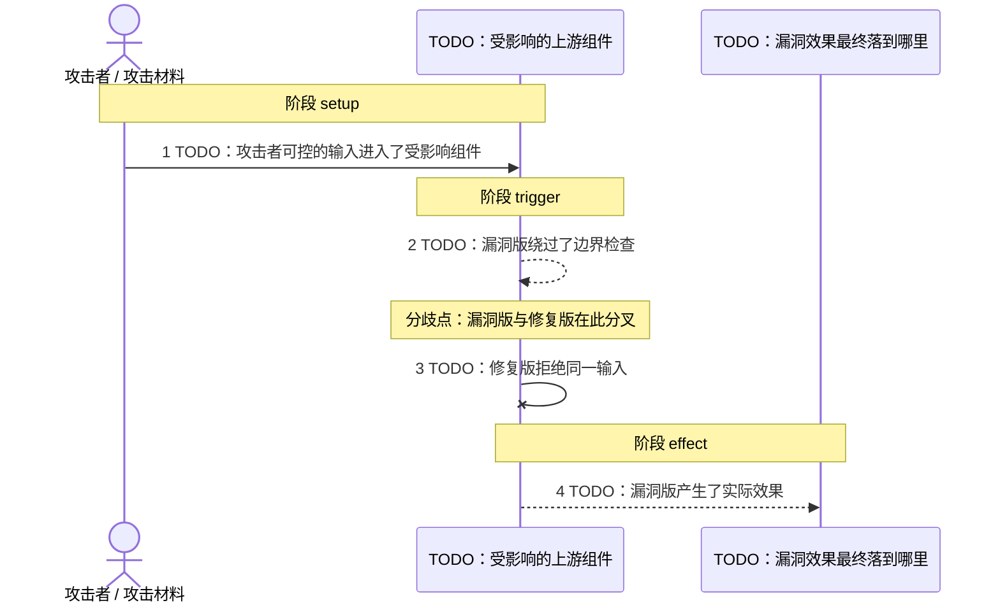
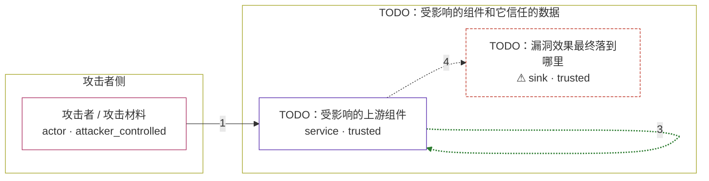

# vu-212479 / CVE-2026-90999

状态：草稿，未完成环境和复现。这个目录由模板生成，不构成漏洞确认。

图解的唯一来源是 `diagram.toml`：编辑后运行 `python3 -m runner diagram vu-212479/CVE-2026-90999` 重新生成下方的图解区块。图解必须覆盖漏洞涉及的每个主体，并标出漏洞版/修复版的分歧步骤。

<!-- diagram:begin (generated from diagram.toml by `python3 -m runner diagram`; edit diagram.toml, not this block) -->
## 漏洞图解 — vu-212479 / CVE-2026-90999 漏洞图解

TODO：用 2~4 句讲清三件事：漏洞的根因是什么、绕过了哪道边界、漏洞本身会造成什么效果。

### 涉及主体

| 主体 | 类型 | 信任级别 | 在漏洞里的作用 | 来源 |
| --- | --- | --- | --- | --- |
| 攻击者 / 攻击材料 (`attacker`) | `actor` | `attacker_controlled` | TODO：这个主体能控制什么输入，它在漏洞里起什么作用。 | — |
| TODO：受影响的上游组件 (`target`) | `service` | `trusted` | TODO：这个组件执行的哪段校验或调用有缺陷，边界为什么没拦住。 | — |
| ⚠ TODO：漏洞效果最终落到哪里 (`effect`) | `sink` | `trusted` | TODO：漏洞触发后效果落在哪里。如果这里是本仓库合成的 marker，请说明它不是真实的外部目标。 | — |

**信任边界**

- **攻击者侧** (`attacker_side`)：成员 `attacker`。TODO：攻击者在这里能控制什么、不能控制什么。
- **TODO：受影响的组件和它信任的数据** (`product`)：成员 `target`、`effect`。TODO：这道边界本来挡住什么，漏洞又是怎么让它失效的。

标 ⚠ 的主体是本仓库合成的替身或无害效果载体，不代表真实外部目标。

### 触发过程

### 主体与信任边界

箭头上的数字是上面的步骤编号；方框只标主体和信任级别，具体动作见「触发过程」。

**分歧点**：第 2 步（`vulnerable_only`）TODO：漏洞版绕过了边界检查。
**分歧点**：第 3 步（`patched_only`）TODO：修复版拒绝同一输入。
<!-- diagram:end -->

## 公告与机制

- 官方公告：[CERT/CC VU#212479](https://kb.cert.org/vuls/id/212479)（2026-09-16）、[NVD CVE-2026-90999](https://nvd.nist.gov/vuln/detail/CVE-2026-90999)（CVSS v3.1 **9.8 CRITICAL**，状态 Deferred，无 CPE 配置）。
- 漏洞根因：Seer 在把 issue 交给 coding agent 时，把错误事件字段（事件标题/消息、异常帧消息）**作为可信系统上下文**呈现给 agent，没有做任何信任标记或净化（CERT 原文："Seer presents this text to the coding agent as trusted system context"）。
- Agent 信任边界：遥测摄入侧。Sentry DSN 按设计是公开的（嵌在前端/客户端代码里），任何人无需受害者 Sentry 账号、源码仓库或基础设施访问权即可向其提交伪造事件；但 Seer 的自动化流程把这类本应不可信的事件内容提升为 agent 的**可信指令通道**，coding agent 据此执行攻击者提供的命令。
- 受影响范围与修复来源：受影响对象是 Sentry 托管的闭源 Seer 服务（NVD 记 affected version 为 "Web site"）。截至 2026-10-21 无厂商修复、无补丁 commit、无修复版本发布。

## 前提

攻击前提（真实攻击场景，非本仓库可复现条件）：

- 一个攻击者可达的 Sentry DSN（公开嵌入在受害者客户端代码中）；
- 受害者项目启用了 Seer 对 issue 的**自动 coding agent 交接**；
- 攻击者无需任何认证、无需访问受害者 Sentry 账号/源码仓库/基础设施。

本仓库的可复现前提：**不存在**——见下节。

## 版本与启动

TODO：补全 metadata、Dockerfile/镜像 digest 和 Compose，再写出精确启动命令。

Compose 中 `vulnerable` 与 `patched` profiles 分开使用；未指定 profile 不启动服务。镜像变量未配置时 Compose 会明确报错。此模板不暴露宿主端口，也不挂载主机数据。

## 机制复现

**阻塞，保持 `not_run`。** 按环境执行协议，无法取得固定漏洞版/修复版发布物时应记录阻塞并保持 `not_run`。2026-10-21 复核：

- 受影响产品是 Sentry 闭源托管 Seer 服务，无本地部署形态；
- 原 `getsentry/seer` 源码仓库已不可访问（HTTP 404），未发现公开 fork，Software Heritage 无该 origin 快照；
- Docker Hub / GHCR 均无 `getsentry/seer` 镜像，`getsentry/self-hosted` compose 套件也不含 seer 服务——binary provenance 同样无法固定；
- 无上游修复 commit / 修复版本，vulnerable/patched 对照无从建立；
- NVD 记录状态仍为 Deferred，无 CPE 配置、无厂商补丁引用。

唯一能走真实漏洞路径的方式是对线上 SaaS 做云端复现，其结果无法被本 runner 固定与复核，故不作为证据。
两脚本统一接受 `--context <context.json> --output <目录>`，详细字段见仓库 `docs/environment-contract.md`。
PoC 输出 `facts.json` 和效果文件；验证器只读证据，输出含 `target_ready` 及对应效果断言的 `verdict.json`。
镜像必须包含 Python 3 和 `/lab/` 下的脚本、fixtures；`runtime.mode` 选择 `oneshot` 或有 healthcheck 的 `service`。

## 端到端复现

TODO：实现 `end_to_end.py`；若不需要模型，明确写出不适用原因。真实模型的结果与机制复现分开统计。

## 验证与修复对照

TODO：实现 `verify.py`。记录漏洞版无害效果、修复版阻断和正常任务成功的证据，不能把服务启动失败当成阻断。

## 清理

默认运行器按每个测试的唯一 Compose project 清理容器、网络和 volume。
`--keep-on-failure` 保留失败项目，项目标识和 Compose 配置在结果目录中；仅清理该项目，不能使用全局 prune。

## 失败诊断

TODO：为本漏洞写出预期效果缺失、修复版仍有越界效果、正常任务失败及前提不满足时的具体排查路径。
启动失败、健康检查失败和超时都不能当作修复阻断。报告中应能定位到阶段、预期、实际和受控证据。

## 构建与输入

TODO：填写两版源码 archive、完整 commit，记录 `build.inputs` 中每个下载的 SHA-256；依赖安装必须支持禁网构建。
固定攻击和正常输入放入 `fixtures/` 并登记到 `fixtures/manifest.toml`。固定 seed、环境变量，说明无害效果与真实影响的关系。

## 隔离例外

默认无例外。确需例外时同时填写 `runtime.exceptions`、理由及最小范围，晋升由两位维护者审阅。

## 来源与许可

TODO：列出引用代码、fixtures 和镜像的来源及许可。
