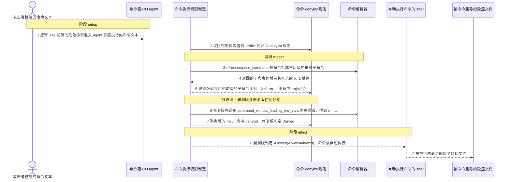
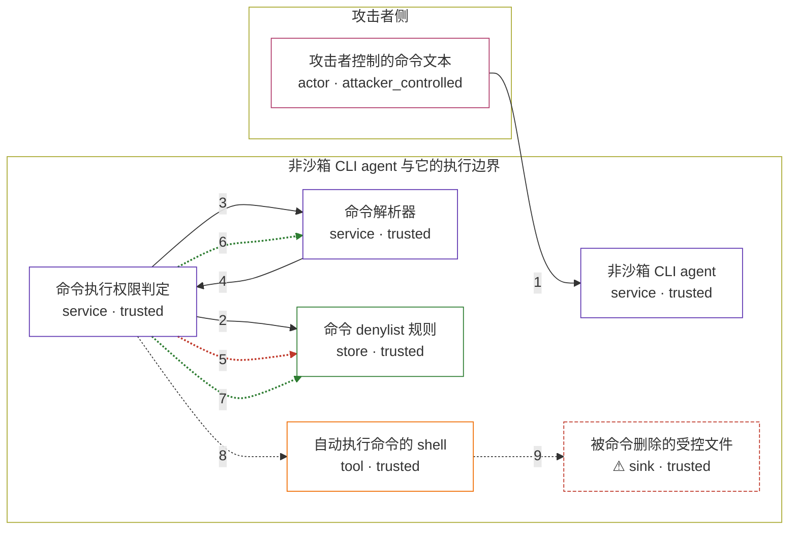

# warp / CVE-2026-48721

状态：草稿，未完成环境和复现。这个目录由模板生成，不构成漏洞确认。

图解的唯一来源是 `diagram.toml`：编辑后运行 `python3 -m runner diagram warp/CVE-2026-48721` 重新生成下方的图解区块。图解必须覆盖漏洞涉及的每个主体，并标出漏洞版/修复版的分歧步骤。

<!-- diagram:begin (generated from diagram.toml by `python3 -m runner diagram`; edit diagram.toml, not this block) -->
## 漏洞图解 — warp / CVE-2026-48721 漏洞图解

Warp 的默认非沙箱 CLI agent profile 在非交互模式下运行，命令 denylist 是唯一能阻止危险命令自动执行的边界。命令字符串在剥离开头的 KEY=VALUE 赋值之前就与 denylist 规则比对，因此 X=1 rm … 拆出的子命令不匹配 rm(\s.*)?，判定落到 AlwaysAllow 并自动执行；修复版先剥离前缀环境变量再比对，同一命令被判为 Denied。

### 涉及主体

| 主体 | 类型 | 信任级别 | 在漏洞里的作用 | 来源 |
| --- | --- | --- | --- | --- |
| 攻击者控制的命令文本 (`attacker`) | `actor` | `attacker_controlled` | 让 agent 读到的内容里混入一条以 KEY=VALUE 前缀开头的危险命令，从而决定 agent 将要执行的命令字符串。攻击者拿不到 denylist 配置，也不能自己执行命令。 | — |
| 非沙箱 CLI agent (`agent`) | `service` | `trusted` | 在非交互模式下把模型产出的命令字符串交给权限判定，判定为 Allowed 时自动执行这条命令。 | — |
| 命令执行权限判定 (`permission_gate`) | `service` | `trusted` | can_autoexecute_command 先做 denylist 匹配，匹配在其它条件之前生效。漏洞版拿 decompose_command 返回的原始子命令去比对，修复版先经 command_for_execution_predicates 剥离前缀环境变量。 | app/src/ai/blocklist/permissions.rs |
| 命令解析器 (`command_parser`) | `service` | `trusted` | decompose_command 把命令拆成每个层级的重组子命令，供权限判定使用；拆分本身不会去掉开头的 KEY=VALUE 赋值。 | crates/warp_completer/src/parsers/simple/mod.rs |
| 命令 denylist 规则 (`denylist`) | `store` | `trusted` | 当前 profile 中禁止自动执行的命令正则，含 rm(\s.*)?，是该 profile 唯一的拦截边界。 | — |
| 自动执行命令的 shell (`shell`) | `tool` | `trusted` | 权限判定返回 Allowed 后，agent 通过它运行这条命令。 | — |
| ⚠ 被命令删除的受控文件 (`canary`) | `sink` | `trusted` | 这条被放行的命令作用的目标文件，代表真实场景中被 denylist 保护的破坏动作落点。 | — |

**信任边界**

- **攻击者侧** (`attacker_side`)：成员 `attacker`。攻击者只能影响 agent 读到的文本以及由此产生的命令字符串；denylist 规则和权限判定都在边界另一侧。
- **非沙箱 CLI agent 与它的执行边界** (`cli_profile`)：成员 `agent`、`permission_gate`、`command_parser`、`denylist`、`shell`、`canary`。非交互 profile 依赖 denylist 决定哪些命令需要确认。漏洞让 denylist 匹配发生在剥离前缀环境变量之前，这道边界因此失效。

标 ⚠ 的主体是本仓库合成的替身或无害效果载体，不代表真实外部目标。

### 触发过程

### 主体与信任边界

箭头上的数字是上面的步骤编号；方框只标主体和信任级别，具体动作见「触发过程」。

**分歧点**：第 5 步（`vulnerable_only`）漏洞版直接用带前缀的子命令比对，X=1 rm … 不命中 rm(\s.*)?。
**分歧点**：第 6 步（`patched_only`）修复版先调用 command_without_leading_env_vars 剥离前缀，得到 rm …。
<!-- diagram:end -->

## 公告与机制

TODO：官方公告、漏洞根因、Agent 信任边界、受影响范围和修复来源。

## 前提

TODO：认证要求、用户交互、已有批准、工具权限、攻击者能控制的内容。

## 版本与启动

TODO：补全 metadata、Dockerfile/镜像 digest 和 Compose，再写出精确启动命令。

Compose 中 `vulnerable` 与 `patched` profiles 分开使用；未指定 profile 不启动服务。镜像变量未配置时 Compose 会明确报错。此模板不暴露宿主端口，也不挂载主机数据。

## 机制复现

TODO：实现 `reproduce.py`，固定输入并执行真实漏洞路径，注明运行位置、参数和超时。

完成实现后使用 `python3 -m runner reproduce warp/CVE-2026-48721 --build --rounds 3`。
两脚本统一接受 `--context <context.json> --output <目录>`，详细字段见仓库 `docs/environment-contract.md`。
PoC 输出 `facts.json` 和效果文件；验证器只读证据，输出含 `target_ready` 及对应效果断言的 `verdict.json`。
镜像必须包含 Python 3 和 `/lab/` 下的脚本、fixtures；`runtime.mode` 选择 `oneshot` 或有 healthcheck 的 `service`。

## 端到端复现

TODO：实现 `end_to_end.py`；若不需要模型，明确写出不适用原因。真实模型的结果与机制复现分开统计。

## 验证与修复对照

TODO：实现 `verify.py`。记录漏洞版无害效果、修复版阻断和正常任务成功的证据，不能把服务启动失败当成阻断。

## 清理

默认运行器按每个测试的唯一 Compose project 清理容器、网络和 volume。
`--keep-on-failure` 保留失败项目，项目标识和 Compose 配置在结果目录中；仅清理该项目，不能使用全局 prune。

## 失败诊断

TODO：为本漏洞写出预期效果缺失、修复版仍有越界效果、正常任务失败及前提不满足时的具体排查路径。
启动失败、健康检查失败和超时都不能当作修复阻断。报告中应能定位到阶段、预期、实际和受控证据。

## 构建与输入

TODO：填写两版源码 archive、完整 commit，记录 `build.inputs` 中每个下载的 SHA-256；依赖安装必须支持禁网构建。
固定攻击和正常输入放入 `fixtures/` 并登记到 `fixtures/manifest.toml`。固定 seed、环境变量，说明无害效果与真实影响的关系。

## 隔离例外

默认无例外。确需例外时同时填写 `runtime.exceptions`、理由及最小范围，晋升由两位维护者审阅。

## 来源与许可

TODO：列出引用代码、fixtures 和镜像的来源及许可。
